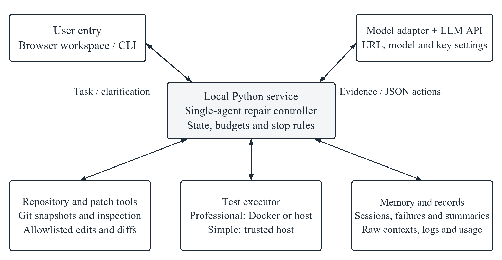
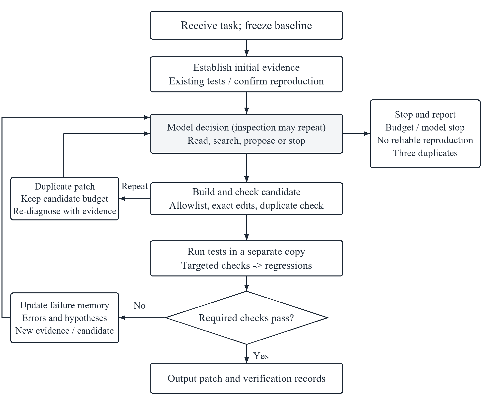

# PatchLab A Test-Driven Autonomous Debugging and Software Repair Agent

COMP7608B Project Group 45

## 1 Group members

| Name | Student ID | Primary responsibility |
| --- | --- | --- |
| Hou Yifu | 3036898738 | Agent core, model integration, repair loop and memory |
| Zhu Wenpu | 3036793380 | Tool calls, test execution, Docker and runtime environments |
| Ma Jinghan | 3036791409 | Dataset preparation, controlled experiments and result analysis |

## 2 Project objective and user scenarios

Repairing a software defect usually requires repeated code inspection, test execution and revision of the diagnosis. A language model can suggest a plausible change, but whether a patch actually fixes the problem depends on the resulting program behavior. PatchLab integrates the model into this debugging process: the model selects evidence to inspect and proposes a change, the execution environment tests it, and the result informs the next decision. The system produces a patch, test results and an execution trace so that users can assess both the reasoning behind the change and its effect.

The project serves two groups of users. Developers who already have failing tests can automate code inspection, candidate repair and regression checks. Users who only know that an operation produces unexpected behavior can start with a problem description. Professional mode lets the first group specify a code revision, editable files and test selectors. Simple mode lets the second group provide a project path, an error and reproduction steps, from which the agent attempts to establish a behavioral test. Both workflows share a browser workspace where users can clarify the problem, follow progress and inspect the final diff.

The delivered system implements the Python single-agent workflow proposed in the project proposal: repository inspection, tool selection, patch generation, test feedback, optional human approval and trajectory logging. It also adds browser interaction, repair without supplied tests and context management. The main evaluation uses the planned thirty repository-level SWE-bench Verified tasks; QuixBugs supports rapid development checks. The delivered scope focuses on Python, excluding the optional Java/Defects4J extension. Regression verification uses task-specific test selections to balance coverage and execution cost, while independent acceptance tests determine final resolution.

## 3 System design and implementation

### 3.1 Architecture and interaction

PatchLab implements a lightweight Python state machine across interaction, decision and execution layers. The browser submits tasks and displays events. A local service maintains sessions and task state, a model adapter produces structured actions, and the execution layer handles repository snapshots, inspection, patch construction and tests. One launcher starts the service and opens the browser. The command-line interface additionally supports batch experiments and human approval.

A single-agent state machine separates model decisions from execution constraints. The model chooses what to inspect and change; the controller checks paths, limits resources, preserves evidence and decides when to stop. This structure makes individual repairs traceable and supports comparisons of feedback and memory strategies using the same tools.

Ordinary chat explains code and clarifies requirements, whereas repair tasks invoke tools. Professional mode creates a copy of a specified Git revision and restricts edits to allowlisted Python source files. Simple mode accepts a local project and an observed problem, then attempts to generate a reproducing test. It proceeds to repair only after a defect-related assertion fails on the original copy. User-supplied startup commands enter the context as background information; the tool layer continues to execute controlled test actions.

Figure 1. System architecture: the model selects actions; the controller coordinates tools, tests and persistent records.

### 3.2 From observation to patch verification

The controller follows an observe, select, execute and update cycle, drawing on the ReAct approach of alternating decisions with environmental feedback [1]. The model returns one JSON action at a time rather than taking control of a terminal. Task state contains the issue description, inspected evidence, recent test results, candidate history, failure memory, call counts and remaining budgets.

| Tool or action | Purpose | Evidence returned |
| --- | --- | --- |
| List and search | Locate relevant modules and symbols | Paths, matching locations and excerpts |
| Read lines | Inspect implementation and call relationships | Bounded source and continuation positions |
| Reproduce | Express the issue as an executable behavior contract | Healthy controls and failures on the base |
| Propose edits | Specify exact source replacements | Diagnosis, target files and unified diff |
| Verify or stop | Run targeted/regression checks; decide whether to continue | Exit codes, failures, time and stopping reason |

A run begins by recording the baseline revision and initial test behavior. The model then inspects relevant source code. For a proposed candidate, the controller checks that each edit location is unique and each file is editable, then constructs a candidate copy from the frozen baseline. Candidates are verified independently so that ineffective changes from an earlier attempt do not remain in the workspace. To retain useful parts of an earlier candidate, the model must explicitly compose them into the new proposal.

Targeted tests check the reported defect, while regression tests check existing behavior. Failure output becomes input to the next decision: the model can gather more evidence, revise its hypothesis or stop. When the required checks pass, the system outputs the final patch and test records. It also returns an explicit stopping status when the call or candidate limit is reached, a reliable reproduction cannot be established, or proposals keep repeating. The trace records concise diagnoses and observable actions, connecting each change to execution evidence.

In the implementation, experiment.py manages the professional repair loop, workbench.py provides repository and execution tools, and decision.py connects the model and validates its actions. The examples discussed below generate traces through this same execution path to check how the design behaves in practice.

Figure 2. Repair workflow: test feedback informs subsequent decisions; the controller bounds repeated proposals and resource use.

### 3.3 Model integration and prompt design

The model is accessed through a compatible chat-completions interface. The endpoint URL, model name and API-key environment variable are configured separately. Switching providers therefore requires configuration changes rather than changes to the controller or tools. Validation uses the DeepSeek service alias deepseek-flash, with temperature 0, thinking disabled and a response limit of 1,200 tokens. Result files retain configuration and implementation hashes, and identify the model by the service alias actually used.

Prompts define action formats, tool boundaries and evidence requirements. Repository text and test output are treated as data; only authorized source files may be edited; tests must not be deleted, skipped or weakened to manufacture success. After a failure, the model should explain how new evidence affects its diagnosis. Reproduction prompts additionally require public APIs, behavioral assertions and a healthy-input control. When a duplicate patch is blocked, the controller requires renewed diagnosis: obtain new evidence, propose a different justified edit, or stop explicitly. Runtime prompts and redacted task contexts accompany the source code.

## 4 Memory management and reliability

### 4.1 Session context and failure memory

Debugging requires remembering what has already been investigated without allowing old output to crowd out current evidence. PatchLab separately manages session history, active context and failure memory. Session history retains user requirements and clarifications; active context supplies information for the current decision; failure memory records each candidate's hypothesis, edit excerpts, failure stage and key test evidence, helping the model recognize approaches that have already been disproved.

When context reaches a threshold, the system asks the model to summarize older material, retains recent observations and replaces older active history with the summary. Default thresholds are approximately 12,000 serialized characters for repair context and 16,000 for chat, with message counts also considered. Summaries preserve goals, constraints, identifiers and failure conclusions; original inputs and events remain archived separately. If compaction fails, bounded excerpts of the original material preserve evidence so that one summary failure does not discard the task state.

### 4.2 Failure detection and bounded recovery

A recurring form of stagnation during development was the repeated submission of the same patch. The system detects duplicates using diff fingerprints, retains the original failure evidence and requires renewed diagnosis. Duplicates do not consume a new effective candidate, but still count toward calls and tokens. Three consecutive duplicates without a novel candidate terminate the task. This preserves candidate budget for useful exploration and provides a clear exit when progress stops.

We tested this mechanism through fault injection: a scripted policy repeatedly proposed return 0. This patch passed the reversed-interval target but broke positive intervals. Real pytest output triggered regression rejection; after three duplicates were blocked, the controller stopped with status stagnated, recording one effective candidate, three duplicates and five decisions. This case tests controller behavior. Scripted policies are labelled separately from live-model experiments.

A second check tested process timeouts. The test deliberately slept for thirty seconds while the executor imposed a one-second timeout. The Docker integration check confirmed termination and a timeout result, which the controller did not treat as a pass. A read-only execution check also confirmed that ordinary tests could complete in the restricted container. Both integration checks passed.

Transient provider failures receive at most three attempts with exponential backoff and jitter; rate-limit responses may supply a bounded Retry-After delay. Invalid edits and behavioral test failures return to the repair process for analysis, while configuration and credential problems are reported to the user. Retries can incur additional paid requests, so actual provider usage is recorded separately rather than hidden within a successful result.

### 4.3 Execution boundaries and quality requirements

Professional mode can run tests in prebuilt Docker images with networking disabled, read-only mounts and resource limits. Simple mode and explicitly selected host execution are intended for trusted projects. Candidate patches are verified in copies; users inspect them before deciding whether to modify the original project. The CLI can also require human approval before candidate verification. The browser exposes observations, proposals, tests and stopping reasons to make progress visible during longer tasks.

| Quality objective | Measures and observations |
| --- | --- |
| Bound time and cost | Call and candidate limits, test timeouts, duplicate stopping and bounded backoff; validation records time and actual/equivalent tokens |
| Traceability | JSONL events, actual decision contexts, candidate diffs, test results and source hashes support task-level inspection |
| Project and key protection | Source allowlists, protected tests, temporary copies and local access tokens; personal settings and keys excluded from submission |
| Startup and portability | Windows/macOS launchers and separate model configuration; Python and Git are required, with Docker for isolated tests |

When an external model is used, selected source code and execution evidence are sent to the configured provider. Logs remain local and are redacted for export. Deployment should select a provider and execution mode appropriate to the project's data requirements. This is a practical trade-off between convenient model integration and code privacy.

## 5 Experimental design and results

### 5.1 Development and validation tasks

Experiments were organized into development and validation stages. The original forty repository-level tasks formed the development set, completed in three batches across eleven open-source repositories, including Django, SymPy, Sphinx and Requests. They covered framework behavior, numerical computation, documentation builds and network interfaces, exposing the agent to different code structures and test environments. Small Python defects from QuixBugs provided faster toolchain checks [3].

Final validation uniformly used thirty additional SWE-bench Verified tasks [2], with no task-ID overlap with the forty development tasks. The validation set contains fifteen Django, twelve SymPy and three pytest tasks. Selection considered dependency reproducibility and task size, covering local logic defects, framework behavior and boundary conditions. Task IDs, public baselines and configuration were fixed before the uniform run.

The stages serve different purposes: forty tasks informed system improvements, while thirty tasks compare the three conditions in the current version. Results from different implementations are not combined into one success rate.

To reduce environmental interference with repair evaluation, dependencies and test images were prepared in advance and checked against buggy baselines, reference repairs and existing regressions. The agent could not access reference patches or independent acceptance feedback.

### 5.2 Development results and optimization rationale

During development, a task was considered solved only if it passed independent acceptance; tasks without a patch remained in the denominator. The original results of the three batches are shown below. Aggregate resolution rates were 47.5%, 37.5% and 42.5%, respectively.

| Development batch | Tasks | Single | Feedback | Memory |
| --- | --- | --- | --- | --- |
| First | 10 | 4/10 | 4/10 | 5/10 |
| Second | 10 | 6/10 | 4/10 | 5/10 |
| Supplemental | 20 | 9/20 | 7/20 | 7/20 |
| Total | 40 | 19/40 (47.5%) | 15/40 (37.5%) | 17/40 (42.5%) |

These results prompted us to examine how iterations were used rather than simply increasing their number. In the supplemental twenty-task cohort, feedback and memory each exhausted the decision budget nine times. They repeated identical inspection actions 57 and 55 times, respectively, compared with 22 for single. Fifteen single-condition candidates passed public checks, but only nine passed independent acceptance. Thus, repeated exploration consumed budget, while public checks did not fully cover the reported defects.

| Observation from development traces | Implementation change |
| --- | --- |
| Repeated inspection consumed the repair budget | Expose remaining decisions; cache identical reads/searches on frozen snapshots; return continuation positions for bounded reads. |
| Public checks passed but acceptance failed | Add defect-specific reproductions and healthy controls; freeze confirmed tests; distinguish public-check status from resolved. |
| Failed approaches persisted; later retests repeated patches | Store hypotheses, edits and evidence in a failure ledger; block diff fingerprints, require renewed diagnosis and stop after three consecutive duplicates. |
| Summary, service or environment faults interrupted tasks | Retain bounded original evidence on summary failure; retry transient errors with bounded backoff; precheck dependencies, images and imported source. |

We next selected three failure cases, SymPy-16766, scikit-learn-10297 and xarray-6721, for a targeted development retest. With the same task revisions and budgets, feedback improved from 0/3 to 3/3, memory from 1/3 to 3/3, and single remained at 3/3. Expanding the retest to the same supplemental twenty tasks reduced total decisions from 574 to 434, approximately 24.4%. Tasks producing no patch fell from ten to two for feedback and from nine to three for memory. These observations support improved use of exploration and candidate-generation budgets through better evidence management.

The forty development tasks underwent environment adaptation and recovery-policy changes, so their results are retained as diagnostic evidence. Targeted retests check the repair mechanisms. Final effectiveness is evaluated separately on thirty tasks under one implementation; differences between the two task sets' resolution rates are not interpreted as a direct estimate of optimization gains.

### 5.3 Comparison conditions and evaluation method

All three conditions use the same model, task inputs and tools, with at most sixteen decisions per task. They differ in candidate limits and how feedback history is organized.

| Condition | Candidate limit | Feedback and memory |
| --- | --- | --- |
| Single attempt (single) | 1 | Inspect before proposing; no revision from post-patch feedback |
| Iterative (feedback) | 5 | Revise using recent failures and the previous candidate |
| Iterative with memory | 5 | Also retain structured failed hypotheses and evidence |

The primary metric is independent acceptance rate: a patch must apply and pass the retained upstream acceptance tests. The controller's verified and candidate_ready labels describe run states; independent scoring determines resolved status. Tasks without a patch and tasks that stop normally without a solution remain in the denominator. Secondary metrics include effective candidates, duplicate proposals, model calls, tokens and end-to-end time. Judgments rely on executable tests rather than subjective LLM scoring.

Batch execution reuses responses to identical inputs before the first candidate to avoid paying repeatedly for shared prefixes. Subsequent candidates are still tested separately. Actual tokens count physical API usage. Equivalent tokens charge reused content to each condition, representing its standalone-equivalent workload. Both measures are reported below; efficiency comparisons primarily use equivalent tokens.

### 5.4 Validation results

Thirty tasks across three conditions produced ninety runs and independent scores. Every task received a scoring result, with no scoring execution errors. The table summarizes the current implementation.

| Condition | Resolved | Rate | Equivalent tokens | Actual tokens | Median time (s) |
| --- | --- | --- | --- | --- | --- |
| Single | 21/30 | 70.0% | 479,479 | 479,479 | 223.9 |
| Feedback | 19/30 | 63.3% | 592,028 | 217,241 | 255.2 |
| Memory | 22/30 | 73.3% | 606,927 | 236,196 | 252.7 |

Memory achieved the highest resolution count: one more task than single and three more than feedback. Relative to single, its equivalent token usage increased by approximately 26.6%, and median time increased by 28.8 seconds. Extra iterations provide an opportunity to recover, but their value cannot be inferred from iteration count alone.

Single still solves most tasks because it can inspect and search code before its first candidate, and some defects need only a local edit. Further improvement through iteration depends on whether tests supply useful new information and whether the model changes its diagnosis accordingly. Memory blocked eleven duplicate proposals and feedback blocked ten. These proposals still incur call costs but do not repeatedly consume effective candidate slots.

Django-11206 illustrates a successful use of feedback. Very small Decimal values entered the scientific-notation branch even when decimal places were specified. Memory's first candidate still routed 1e-200 into that branch. The next diagnosis used the recorded failure to identify why the condition remained true and revised the magnitude and decimal-place checks. The second candidate passed independent acceptance, whereas the other conditions did not resolve this task. The trace supports a specific observation: in this run, retaining the failed condition helped the model justify a more precise revision.

### 5.5 Discussion

Feedback performed worse than single, highlighting the need to check feedback quality. In SymPy-15345, a generated reproducer specified the wrong output-argument order. Iteration rejected a correct direction and produced an edit that satisfied the erroneous assertion. Reproducers therefore need healthy controls and existing API conventions; failure on the original version is not sufficient by itself. Django-11133 instead exposed inadequate public regression coverage: a candidate bypassed a branch without correctly converting memoryview content to bytes, and independent acceptance detected the defect.

These results are observations from one run per task and condition on a fixed validation set. Outputs may vary even at temperature 0, and first candidates were not identical in every comparison. Deliberate task selection and pilot runs also affect the scope of the conclusions. The 73.3% rate therefore describes this configuration on these thirty tasks. Broader benefits require more tasks and repeated runs. In practical use, test quality, failure memory and budget control must work together.

## 6 Interactive examples and execution checks

Alongside repository-level evaluation, three runnable examples demonstrate an ordinary task, a changed request and a failure case using the same small project. The first two use the live deepseek-flash model. The failure case uses an explicitly labelled scripted policy. All three execute real repository and test tools.

| Example | Task and execution | Observed result |
| --- | --- | --- |
| Ordinary task | Fix reversed intervals in duration; inspect source, clamp negative durations to zero and preserve positive seconds | One candidate, two model calls, 1,193 tokens; target and two regression tests passed |
| Changed request | Apply the accepted patch, then request minutes with fractional values; inspect the new test contract | One candidate, three model calls, 1,885 tokens; target and three regression tests passed |
| Failure case | Repeatedly propose a patch that breaks positive intervals; check regression rejection and duplicate stopping | One effective candidate; stopped after three duplicates, retaining failure evidence |

For the changed request, the accepted patch is explicitly applied to a disposable example project before starting a new task, keeping conversation context and source state consistent. The example script also offers a deterministic mode without API calls for checking tool execution and stopping rules. Inputs, steps, expected outcomes, actual events and patches are supplied with the source code.

The application runs through a Python entry point and platform launchers, independently of notebooks. The README provides model and key configuration, dependencies and evaluation commands.

## 7 Conclusion

PatchLab combines code understanding, tool use, test execution and failure-driven revision in an interactive, traceable repair system. The model selects its next action from available evidence, while the controller enforces explicit boundaries on editing, verification and stopping. The browser lowers the effort of submitting a task, and professional test configuration and batch interfaces retain experimental control.

Forty development tasks informed improvements to the workflow, followed by a uniform comparison on thirty validation tasks. Memory resolved the most tasks, 22/30, at a higher equivalent token cost. Results and traces show that effective repair depends on turning failures into new evidence and justified edits. Structured memory and bounded recovery provide concrete support for that process.

## 8 Contributions and attribution

Zhu Wenpu was responsible for tools and execution environments, including repository inspection, patch verification, Docker and dependency adaptation.

Hou Yifu was responsible for the agent core and model integration, including action decisions, the repair loop, context and failure memory.

Ma Jinghan was responsible for data and experiments, including task preparation, the three-condition comparison and result analysis. These components were integrated into one application supporting interactive use and repository-level evaluation.

The system uses Python, pytest, Git and Docker. Benchmark tasks come from SWE-bench Verified and QuixBugs; source and license information accompany the project. OpenAI Codex assisted implementation, testing, troubleshooting and documentation, while the DeepSeek API supplied agent decisions during experiments. The group is responsible for requirements, design choices, evaluation rules and the final deliverable. An AI-use declaration and the recoverable project prompt record accompany the source.

## References

[1] Shunyu Yao, Jeffrey Zhao, Dian Yu, Nan Du, Izhak Shafran, Karthik Narasimhan, and Yuan Cao. ReAct: Synergizing Reasoning and Acting in Language Models. ICLR, 2023. https://arxiv.org/abs/2210.03629

[2] Carlos E. Jimenez, John Yang, Alexander Wettig, Shunyu Yao, Kexin Pei, Ofir Press, and Karthik Narasimhan. SWE-bench: Can Language Models Resolve Real-World GitHub Issues? ICLR, 2024. https://arxiv.org/abs/2310.06770

[3] Derrick Lin, James Koppel, Angela Chen, and Armando Solar-Lezama. QuixBugs: A Multi-Lingual Program Repair Benchmark Set Based on the Quixey Challenge. SPLASH Companion, 2017. https://github.com/jkoppel/QuixBugs

